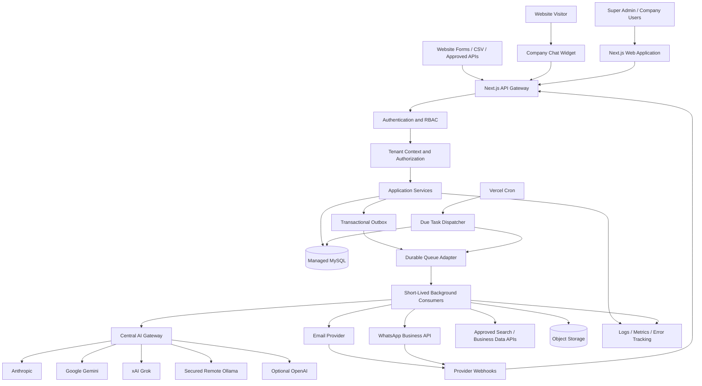

# AI Lead Generation & Sales Automation SaaS
## Product Requirements, UI/UX Design, Technology Stack & System Architecture

**Document version:** 1.1  
**Status:** Proposed product specification  
**Deployment target:** Vercel  
**Application type:** Multi-tenant SaaS, built as a Next.js monolith  
**Primary language:** TypeScript  
**Database:** MySQL  
**Primary users:** Super Admin, Company Admin, Sales Manager, Sales Representative

---

# 1. Product Vision

Build a professional, responsive, AI-powered lead generation and sales automation platform. It should collect leads from multiple authorized sources, qualify and prioritize them with AI, manage customer conversations, and help sales teams follow up consistently.

The product should support two operating modes:

1. **Platform mode:** The platform owner configures shared AI providers and integrations for subscribed companies.
2. **Bring Your Own Key (BYOK) mode:** A company can optionally configure its own provider credentials, subject to plan permissions.

The first release should be designed so that it can start with one business and later support multiple companies without redesigning the database or authorization model.

## 1.1 Product goals

- Capture inbound leads and import or discover outbound prospects through approved sources.
- Support lead generation across multiple industries, products, services and customer requirements, not only software.
- Let each company create separate campaigns for different business verticals, target audiences and lead qualification rules.
- Keep all leads in one searchable CRM.
- Use AI to extract requirements, summarize conversations, and recommend next actions.
- Provide a configurable website chatbot for each company.
- Automate approved email and WhatsApp workflows.
- Support human review before external messages are sent.
- Give Super Admins control over AI providers, models, credentials, usage and limits.
- Deploy the web application on Vercel without relying on n8n.
- Keep the architecture provider-independent and cost-aware.

## 1.2 Non-goals for the initial release

- Unauthorized LinkedIn scraping, browser automation or unsolicited LinkedIn messaging.
- Unrestricted bulk email or WhatsApp messaging.
- Running a permanent worker process inside a Vercel Function.
- Running a local Ollama process inside Vercel.
- Promising that every AI model or integration is free.
- Automatically publishing or sending external content without configured consent and approval rules.

---

# 2. User Roles & Permissions

Use role-based access control (RBAC), with tenant isolation enforced in backend services and database queries.

| Role | Main permissions |
|---|---|
| Super Admin | Manage tenants, plans, global settings, AI providers, platform integrations, limits, audit logs and system health |
| Company Owner | Manage their company, users, integrations, chatbot, campaigns, AI settings and billing-related settings |
| Company Admin | Manage company users, leads, integrations and automation settings, within granted permissions |
| Sales Manager | View team pipeline, assign leads, approve messages and review performance |
| Sales Representative | View assigned leads, update lead status, manage conversations and complete follow-ups |
| Read-only Analyst | View permitted reports and dashboards without changing records |

### Permission requirements

- Every company-owned record must be scoped by `tenant_id`.
- A user must never access another tenant's records by changing an ID in a URL or API request.
- Super Admin access must be separate from ordinary company administration.
- Sensitive actions require audit events.
- Permission checks must run on the server, not only in the UI.
- Support configurable permissions where practical, but keep the first version's roles understandable.

---

# 3. Product Modules

## 3.1 Super Admin Console

The Super Admin console manages the platform itself.

Features:
- Platform overview and health indicators.
- Company/tenant management.
- Subscription plan and feature entitlements.
- Global integrations.
- AI provider and model management.
- Platform-wide usage and cost reporting.
- System logs, failed jobs and webhook health.
- User administration and audit logs.
- Global security and rate-limit settings.

## 3.2 Company Workspace

Each company receives an isolated workspace.

Features:
- Company profile, logo, brand colors and timezone.
- Team and role management.
- Lead sources and integrations.
- CRM pipeline configuration.
- AI chatbot configuration.
- Knowledge base management.
- Campaign and follow-up settings.
- Company-level AI model selection, if permitted.
- Usage dashboard and plan limits.

## 3.3 Lead Source Integrations

Use a source-adapter design. Each adapter validates and converts source-specific payloads into a common internal lead format.

Initial sources:

| Source | Integration approach | Notes |
|---|---|---|
| Company website | Public form endpoint / signed webhook | Protect with rate limits, CAPTCHA or bot detection |
| CSV / Excel | Authenticated upload and background import | Validate rows and show import errors |
| Google Maps / Places | Official Google Places API | Follow attribution, storage and permitted-use rules |
| Google Search | Approved search provider/API | Respect provider terms and source attribution |
| LinkedIn | Official Lead Gen Forms integrations or authorized exports/APIs | No unauthorized scraping or automated account activity |
| Meta Lead Ads | Official Meta lead webhooks/API | Requires app permissions and review where applicable |
| CRM integrations | OAuth/API/webhooks | Start with the integration that has confirmed demand |
| Manual entry | CRM form | Record source and owner |

Each integration should have:
- Connection status.
- Configuration and credential reference.
- Last successful sync.
- Last error and retry status.
- Test connection action, where supported.
- Enable/disable control.
- Source-specific consent and attribution metadata.

Do not store third-party data indefinitely unless the provider terms allow it. Keep source-specific retention rules.

## 3.4 Multi-Industry Lead Generation & Requirement Categories

The platform must support lead generation for different industries and customer requirements. It must not be hard-coded for software leads only.

A company can create multiple lead-generation campaigns at the same time. Each campaign selects an industry, business category, product/service, target audience, location, lead sources and qualification questions.

### Supported industry examples

| Industry / category | Example lead requirements | Useful qualification fields |
|---|---|---|
| Software and IT | ERP, CRM, HRMS, billing software, website, mobile app, AI automation, custom software | Required features, company size, users, budget, timeline, existing system |
| Real estate | Buy property, sell property, rent property, residential flats, plots, commercial property | Buy/rent/sell intent, property type, preferred location, budget, area, bedrooms, possession timeline |
| Readymade products and retail | Clothing, furniture, electronics, appliances, machinery and wholesale goods | Product, quantity, specifications, budget, delivery location, purchase timeline |
| Education | School/college admission, coaching, certification and professional training | Course, qualification, preferred batch, location, budget, joining date |
| Healthcare | Clinic appointments, diagnostic services and healthcare packages | Service requested, preferred location, appointment preference; collect only necessary information |
| Travel and hospitality | Holiday packages, hotel bookings, visa assistance and tours | Destination, travel dates, number of travellers, budget and service type |
| Finance and insurance | Business finance, loans and insurance enquiries | Product requested, broad eligibility details and contact preference; apply applicable legal and privacy requirements |
| Professional services | Digital marketing, SEO, accounting, consulting, recruitment and legal services | Service required, business size, scope, location, budget and expected start date |
| Manufacturing and B2B | Raw materials, industrial equipment, contract manufacturing and distribution | Product/specification, quantity, industry, delivery location and procurement timeline |
| Other / custom | Any company-defined product or service | Admin-defined custom questions and fields |

The platform should allow Super Admins to enable or disable industry templates. Company Admins can use a template as-is or customize it for their own business.

### Campaign setup flow

1. Select an industry or choose **Custom Industry**.
2. Select a product/service or enter a custom requirement.
3. Define the target customer: individual, business, reseller, buyer, seller, tenant, student or another audience.
4. Select target locations and service areas.
5. Select approved lead sources.
6. Configure qualification questions and required fields.
7. Set budget, campaign dates, lead volume target and spending limits where relevant.
8. Select the AI model and lead-scoring profile allowed by the company's plan.
9. Preview the campaign and validate consent, source permissions and outreach rules.
10. Activate the campaign.

### Flexible requirement and custom-field system

Do not create a separate database table or code path for every industry. Use reusable field definitions and campaign-specific field values.

Each field definition should support:
- Field key, display label and description.
- Data type: text, number, date, boolean, single-select, multi-select, URL or location.
- Required/optional setting.
- Validation rules and allowed values.
- Whether the field is visible to sales users or used only for internal qualification.
- Whether it contains personal or sensitive information and requires restricted access.
- Display order and active/inactive status.

A campaign can define its own questions, while reusable industry templates provide sensible defaults.

### Example campaign configurations

**Example A — Software requirement campaign**
- Industry: Software and IT
- Requirement: ERP software for a manufacturing company
- Target audience: Business owners and IT managers
- Questions: Number of employees, number of users, required ERP modules, current software, budget range and implementation timeline
- AI result: Requirement summary, fit score, missing information and recommended sales action

**Example B — Real estate buyer campaign**
- Industry: Real estate
- Requirement: Residential flat purchase
- Target audience: People looking to buy a home
- Questions: Preferred city/locality, property type, budget range, bedrooms, ready-to-move or under-construction preference and buying timeline
- AI result: Buyer intent summary, budget/location fit, urgency and recommended property-sales follow-up

**Example C — Wholesale product campaign**
- Industry: Retail / Wholesale
- Requirement: Bulk furniture purchase
- Target audience: Dealers, retailers and business buyers
- Questions: Product type, quantity, specifications, delivery location and expected purchase date
- AI result: Purchase intent, order potential, missing specifications and recommended sales action

### Lead discovery and compliance rules

- Use official APIs, approved advertising lead forms, licensed data providers, public business data where permitted, company website forms, referrals and authorized imports.
- Do not scrape platforms or collect personal contact details in ways that violate their terms or applicable law.
- Do not assume that publicly visible contact information grants permission for marketing messages.
- Record source, collection method, timestamp, applicable notice and consent or other lawful basis.
- Apply location-specific privacy, marketing and data-retention requirements.
- Provide suppression, deletion and opt-out workflows.

## 3.5 Lead Ingestion & Normalization

Suggested endpoint:

`POST /api/v1/leads/ingest`

Processing:
1. Authenticate the source or validate the public form request.
2. Validate and normalize fields.
3. Apply spam and abuse checks.
4. Record source, campaign and consent metadata.
5. Detect likely duplicates using normalized email/phone and company rules.
6. Create or update a lead according to a configurable merge policy.
7. Write an ingestion event and an outbox job in the same database transaction.
8. Return a lead ID and accepted status.
9. Process enrichment and AI qualification asynchronously.

Example normalized payload:

```json
{
  "source": "website",
  "externalId": "form-submission-123",
  "contact": {
    "name": "Rahul Sharma",
    "email": "rahul@example.com",
    "phone": "+919876543210"
  },
  "company": {
    "name": "ABC Technologies",
    "website": "https://example.com"
  },
  "requirement": "Looking for ERP software",
  "consent": {
    "marketing": false,
    "capturedAt": "2026-11-07T10:00:00Z",
    "method": "website-form",
    "policyVersion": "1.0"
  }
}
```

Consent fields are examples; do not assume consent is true if the source omits it.

## 3.6 CRM & Lead Management

Lead fields:
- Name and contact details.
- Company and website.
- Source and source campaign.
- Industry and location, if lawfully collected.
- Requirement and notes.
- Lead owner and team.
- Status and priority.
- AI summary and qualification result.
- Consent and communication preferences.
- Created, updated and last-contact timestamps.

Suggested pipeline:
- New
- Unreviewed
- Qualified
- Contacted
- Meeting Scheduled
- Proposal
- Won
- Lost
- Disqualified

Features:
- Table and Kanban views.
- Search, filters, sorting and saved views.
- Bulk assignment and permitted bulk updates.
- Lead detail page with activity timeline.
- Duplicate review and merge.
- Notes, tasks and attachments.
- CSV export subject to permissions and data policy.
- Ownership and assignment history.

## 3.7 AI Lead Qualification & Scoring

AI qualification must understand the selected campaign's industry and requirement schema. It must not use one generic scoring prompt for every type of lead.

For each lead, AI should:
- Summarize the customer's actual requirement without changing its meaning.
- Extract values into the campaign's configured fields.
- Identify missing answers and suggest useful follow-up questions.
- Score fit, intent, urgency and completeness separately.
- Explain the score using evidence from the lead's supplied information.
- Recommend the next action for the sales team.
- Return structured, schema-validated output.
- Mark uncertain or unsupported information as unknown rather than inventing it.

The scoring profile must be configurable by campaign. For example, a software campaign may prioritize required modules, budget and implementation timeline, while a real-estate campaign may prioritize location, budget, property type and buying timeline.

AI must not make final lending, insurance, healthcare or other regulated eligibility decisions. In regulated categories, use AI only for permitted administrative assistance and route decisions to qualified human reviewers.


AI extracts structured facts; deterministic application rules calculate the score. Missing facts must remain `unknown`, not be guessed.

Suggested score (configurable per company):
- Requirement fit: 30 points.
- Purchase intent: 25 points.
- Budget evidence: 20 points.
- Company fit/size: 15 points.
- Contact completeness: 10 points.

Suggested bands:
- 80–100: Hot
- 50–79: Warm
- 0–49: Cold

Store:
- Model/provider and model ID.
- Prompt/version identifier.
- Structured result.
- Evidence or source text supporting extracted fields.
- Confidence indicator, where meaningful.
- Token usage and estimated cost.
- Processing status and timestamp.

AI output must be validated against a schema. If parsing or model execution fails, preserve the lead and mark AI processing for retry or review.

## 3.8 AI Research & Enrichment

Research only through approved sources and integrations. Store source references and timestamps.

Possible output:
- Company summary.
- Industry classification.
- Product/service fit.
- Publicly available company details.
- Suggested discovery questions.
- Recommended next sales action.

Do not infer sensitive personal attributes. Do not fabricate revenue, employee count, budget, decision-maker identity or contact information. Label unknown information clearly.

## 3.9 Website AI Chatbot

Each company can create one or more configurable chatbot instances.

Features:
- Responsive floating widget and optional embedded/full-page mode.
- Company logo, colors, greeting and welcome prompts.
- Streaming responses where provider supports it.
- Conversation history.
- Knowledge-base answers using RAG.
- Lead capture flow for name, email, phone and requirement.
- Configurable qualification questions.
- Human handoff and conversation assignment.
- Office hours and offline message.
- Abuse protection, rate limits and usage caps.
- Consent notice and privacy link.
- Allowed domains/origin list.
- Chatbot enable/disable and preview mode.

Chat flow:
1. Visitor opens the widget.
2. Chatbot answers from approved company knowledge.
3. When relevant, it asks permission to collect contact details.
4. It validates details and records the visitor's consent/preferences.
5. It creates or updates a lead.
6. It links the conversation to that lead.
7. It qualifies the lead asynchronously.
8. It offers a human handoff when requested or when confidence is low.

### RAG knowledge base

Supported initial document types:
- PDF, DOCX, TXT and Markdown.
- Manually entered FAQs.
- Approved website pages, subject to site ownership/permission.

Processing:
1. Upload and malware/file-type validation.
2. Extract text.
3. Split into chunks.
4. Generate embeddings through a configured embedding provider.
5. Store vectors in a supported vector store or MySQL-compatible vector solution selected during implementation.
6. Retrieve relevant chunks for each question.
7. Send retrieved context to the LLM.
8. Return an answer with source references where available.

The first version can use a managed vector database or a MySQL-compatible vector capability after compatibility is verified. Keep the retrieval interface abstract so the storage provider can change.

The chatbot must say when the knowledge base does not contain an answer instead of inventing one.

## 3.10 AI Provider & Model Management

Super Admin menu:

`AI Management → Providers & Models`

Initial providers:
- Anthropic Claude.
- Google Gemini.
- xAI Grok.
- Ollama (local and remote).
- OpenAI as an optional provider.
- Additional OpenAI-compatible endpoints where supported.

Admin capabilities:
- Add/edit provider configuration.
- Add model IDs and display names.
- Enable/disable a provider or model.
- Set default provider/model.
- Assign a model to each application module.
- Configure fallback provider/model.
- Set per-tenant and platform usage limits.
- Set monthly budget thresholds.
- Test connection and display a sanitized result.
- View token usage, estimated costs and errors.
- Configure Ollama base URL and available model names.
- View model capabilities (text, vision, embeddings, tool calling, streaming) as configured and verified.

### Suggested module-to-model mapping

All assignments must be editable; these are starting defaults, not hard dependencies.

| Module | Initial assignment |
|---|---|
| Website chatbot | Low-latency, cost-efficient text model |
| Lead extraction | Structured-output-capable model |
| Lead qualification | Cost-efficient reasoning model |
| Company research | Research-capable model with approved search tools |
| Complex analysis | Strong reasoning model |
| Email drafting | Cost-efficient text model |
| Conversation summary | Cost-efficient text model |
| Embeddings | Dedicated embedding model/provider |

### AI Gateway

All application modules must call one internal AI gateway, not provider SDKs directly.

Responsibilities:
- Resolve tenant and module model assignment.
- Check provider availability and budget.
- Load credentials securely.
- Apply prompt and output limits.
- Normalize provider requests/responses.
- Validate structured output.
- Track usage and estimated cost.
- Apply timeout and retry policies.
- Use configured fallback rules.
- Record sanitized errors and trace IDs.

Provider adapter interface (conceptual):

```ts
interface AIProvider {
  generateText(input: GenerateTextInput): Promise<GenerateTextResult>;
  streamText?(input: GenerateTextInput): AsyncIterable<AIStreamChunk>;
  generateStructured?<T>(
    input: GenerateStructuredInput<T>
  ): Promise<T>;
  testConnection(): Promise<ConnectionTestResult>;
}
```

Use Vercel AI SDK where it provides a suitable adapter and capability. Use official provider SDKs or custom adapters where necessary. Do not assume every provider supports identical tools, structured output, streaming or image inputs.

### API key security

- Never store plaintext provider API keys.
- Encrypt credentials at rest using authenticated encryption such as AES-256-GCM.
- Keep the encryption key in Vercel environment variables or a dedicated secrets manager, never in MySQL.
- Never return decrypted keys to the browser.
- Show only masked values after saving.
- Permit credential changes only to authorized admins.
- Audit create, update, test and delete operations.
- Never log API keys, authorization headers or full prompts containing unnecessary personal data.
- Support credential rotation and revocation.
- Consider a managed secrets service for larger production deployments.

### Ollama deployment modes

**Local development:** Next.js runs locally and connects to Ollama at `http://localhost:11434`.

**Vercel production:** Vercel cannot use a developer's `localhost`. Configure a separately hosted Ollama server with private networking or a secured gateway. Do not expose Ollama's port publicly without authentication and network controls.

Ollama models consume the hardware resources of the machine running Ollama. Model selection must account for RAM/VRAM, latency and concurrency.

## 3.11 Campaign Management

Features:
- Create a campaign with name, objective and audience criteria.
- Add leads through filters or manual selection.
- Configure approved message templates.
- Preview and test messages.
- Set send windows, limits and time zone.
- Require approval before launch by default.
- Pause, resume or cancel campaigns.
- Track sent, delivered, bounced, replied and opted-out states where providers expose them.
- Stop future messages when a reply, opt-out or suppression event occurs.

No campaign should send to a contact without a valid legal basis and required consent. Include suppression-list checks immediately before every send.

## 3.12 Email & WhatsApp Communication

Email:
- Use a transactional email provider such as Resend or another configured provider.
- Support verified sender domains.
- Track provider message IDs and delivery events.
- Handle bounce, complaint and unsubscribe webhooks.
- Provide templates and preview.

WhatsApp:
- Use the official WhatsApp Business Platform/Cloud API or an approved provider.
- Respect template, opt-in, conversation-window and policy rules.
- Store message status webhooks.
- Provide opt-out handling and human handoff.
- Do not use unofficial WhatsApp automation libraries.

Human approval:
- Default to draft → review → approve → send.
- Permit automatic sending only for explicitly configured, compliant use cases.
- Store who approved a message and when.

## 3.13 Follow-up Automation

Use a database-backed task scheduler.

Example:
- A lead is qualified.
- A sales representative approves the first email.
- A follow-up task is scheduled for a chosen date/time.
- A scheduled endpoint finds due tasks and publishes jobs.
- The worker rechecks reply, opt-out, suppression and campaign status.
- If still eligible, it sends the message.
- It records the provider response and next action.

Follow-ups must stop when:
- The customer replies, opts out or asks not to be contacted.
- The lead is marked won, lost or disqualified, according to company policy.
- The campaign is paused or cancelled.
- The contact becomes suppressed.
- A company or platform limit is reached.

Use idempotency keys and atomic job claiming to prevent duplicate sends.

## 3.14 Reports & Analytics

Dashboard metrics:
- Total leads and leads by period.
- Leads by source and campaign.
- Hot/warm/cold distribution.
- Lead-to-qualified and lead-to-won conversion.
- Sales pipeline value, if entered by the company.
- Follow-ups due and overdue.
- Chatbot conversations and captured leads.
- Campaign delivery and reply metrics.
- AI requests, tokens and estimated costs by provider/model/tenant.
- Failed jobs and integration health.

Show metric definitions and date/time zone. Do not imply attribution accuracy where source data is incomplete.

---

# 4. Professional UI/UX Design System

The interface should feel like a polished B2B SaaS product: clean, modern, trustworthy, easy to scan and responsive.

## 4.1 Visual direction

Design reference: premium SaaS dashboard with a restrained, professional visual language. Avoid excessive gradients, oversized headings, decorative animations and crowded cards.

### Color palette

| Token | Suggested value | Usage |
|---|---|---|
| Primary | `#4F46E5` | Primary actions, active navigation |
| Primary hover | `#4338CA` | Hover state |
| Accent | `#0F766E` | Secondary highlights |
| App background | `#F8FAFC` | Main light background |
| Surface | `#FFFFFF` | Cards and panels |
| Text primary | `#0F172A` | Main text |
| Text secondary | `#64748B` | Supporting text |
| Border | `#E2E8F0` | Dividers and card borders |
| Success | `#15803D` | Success state |
| Warning | `#D97706` | Warning state |
| Danger | `#DC2626` | Errors and destructive actions |
| Dark background | `#0B1220` | Dark theme background |

Use semantic design tokens so light and dark themes remain consistent. Do not rely on color alone to communicate status.

## 4.2 Typography

- Use Inter or Geist Sans for the interface.
- Use a consistent type scale.
- Page title: 24–30 px desktop, smaller on mobile.
- Section heading: 16–20 px.
- Body: 14–16 px.
- Supporting text: 12–13 px.
- Use medium/semibold weights for hierarchy.
- Maintain readable line height and contrast.

## 4.3 Layout

Desktop:
- Left sidebar: approximately 248 px, collapsible.
- Top header: approximately 64 px.
- Main content: fluid width with a comfortable maximum.
- Use a 12-column grid where useful.
- Use consistent 8 px spacing increments.
- Cards: subtle border, restrained shadow, 10–14 px radius.

Tablet:
- Collapsible sidebar or compact navigation.
- Two-column dashboard cards where space permits.
- Tables may scroll horizontally or switch to compact rows.

Mobile:
- Single-column layout.
- Drawer navigation or bottom navigation for primary sections.
- Filters in a slide-over panel.
- Tables become stacked cards or a carefully designed horizontally scrollable view.
- Forms use full-width controls.
- Chat widget fits within the viewport.
- Primary actions remain easy to reach.
- No horizontal page overflow.

## 4.4 Main navigation

### Super Admin
- Overview
- Companies
- Users
- Plans & Entitlements
- AI Management
  - Providers
  - Models
  - Module Assignments
  - Usage & Costs
  - Fallback Rules
- Platform Integrations
- Queue & Jobs
- System Health
- Audit Logs
- Settings

### Company Workspace
- Overview
- Leads
- Pipeline
- Conversations
- Chatbots
- Knowledge Base
- Campaigns
- Follow-ups
- Integrations
- Team
- Reports
- Settings

## 4.5 Key screens

### A. Login and onboarding
- Minimal, branded sign-in screen.
- Email/password and optional OAuth.
- Password reset and email verification.
- Company onboarding wizard.
- Clear progress indicator.
- Accessible validation and error messages.

### B. Dashboard
Top summary cards:
- Total leads.
- New this week.
- Qualified leads.
- Open opportunities.

Main sections:
- Lead trend chart.
- Lead source breakdown.
- Pipeline summary.
- Recent activity.
- Follow-ups due.
- Integration health.

### C. Leads page
- Searchable data table.
- Filters for source, status, owner, score and date.
- Sortable columns.
- Saved filters.
- Bulk actions with confirmation.
- Export permission check.
- Clear empty, loading and error states.

### D. Lead detail
- Contact and company information.
- AI summary and score with explanation.
- Status and owner controls.
- Conversation timeline.
- Notes and tasks.
- Consent/preferences.
- Related campaign and source.
- Clear action buttons: Assign, Add Note, Schedule Follow-up, Draft Message.

### E. Chatbot builder
Use a step-based layout:
1. Identity and branding.
2. Greeting and behavior.
3. Knowledge sources.
4. Lead capture fields.
5. Human handoff.
6. Allowed domains and security.
7. Preview and publish.

Show a live preview beside the settings on desktop; use tabs on mobile.

### F. AI Provider Management
- Provider cards with status and last-tested time.
- Add provider form.
- Secure API-key input.
- Model catalogue/configuration.
- Test connection action.
- Module assignment matrix.
- Usage and cost charts.
- Budget warning thresholds.
- Fallback configuration.
- Ollama base URL and model list.
- Mask all saved credentials.

### G. Campaign builder

The campaign builder must begin with an industry and requirement selector. It should offer searchable industry templates, custom industry support, target audience, location filters, source selection, qualification questions, scoring configuration and a review step. Users must be able to create separate campaigns for different industries without mixing their qualification rules.

Include example templates such as Software / ERP, Real Estate / Property Buyer, Wholesale / Product Enquiry, Education / Course Enquiry and Professional Services.
- Campaign details.
- Audience selection.
- Message template editor.
- Preview.
- Schedule and send limits.
- Approval step.
- Launch confirmation.
- Performance report.

### H. Conversations inbox
- Conversation list on left.
- Active conversation in center.
- Lead/customer context on right on large screens.
- Assignment and handoff controls.
- AI draft suggestions clearly labeled.
- Human messages and AI messages visually distinct.
- Mobile uses one panel at a time.

## 4.6 Interaction and accessibility

- Use clear button labels and consistent primary/secondary/destructive styles.
- Provide loading, success, empty, validation and error states.
- Confirm destructive actions.
- Use keyboard-accessible menus and dialogs.
- Add visible focus states.
- Use semantic HTML and accessible labels.
- Meet WCAG 2.2 AA contrast and interaction expectations where practical.
- Respect reduced-motion settings.
- Use charts with text summaries or accessible data alternatives.
- Avoid auto-playing sounds or disruptive popups.

---

# 5. Recommended Technology Stack

| Layer | Technology | Reason |
|---|---|---|
| Framework | Next.js App Router | Frontend and backend in one repository |
| Language | TypeScript | Type safety and maintainability |
| UI | Tailwind CSS | Responsive styling |
| Components | shadcn/ui + Radix UI | Consistent accessible interface |
| Icons | Lucide | Consistent icon system |
| Charts | Recharts | Dashboard analytics |
| Forms | React Hook Form + Zod | Validation and form state |
| Database | Managed MySQL | Relational application data |
| ORM | Prisma | Schema and database access |
| Authentication | Auth.js or a vetted auth solution | Session and identity management |
| Authorization | Server-side RBAC | Tenant and role protection |
| AI | Vercel AI SDK + provider adapters | Streaming and model abstraction |
| LLM providers | Anthropic, Google Gemini, xAI Grok, Ollama; optional OpenAI | Provider choice |
| Embeddings | Configurable embedding provider | RAG |
| Vector search | Managed vector service or verified MySQL vector capability | Similarity retrieval |
| Queue | Vercel Queues if available for the project, or managed queue service | Durable background jobs |
| Scheduler | Vercel Cron | Trigger due work |
| Email | Resend or equivalent | Transactional email |
| WhatsApp | Official Meta WhatsApp Business Platform | Compliant messaging |
| File storage | S3-compatible object storage | Documents and attachments |
| Monitoring | Sentry or equivalent | Error tracking |
| Logging | Structured JSON logs | Diagnostics |
| Testing | Vitest + Playwright | Unit, integration and end-to-end tests |
| CI/CD | GitHub + Vercel | Automated deployment |

### Technology selection notes

- Verify current Vercel product availability, plan requirements, limits and pricing before selecting Vercel Queues for production. Keep a queue adapter so another managed queue can be substituted.
- Do not use local phpMyAdmin as the production database. phpMyAdmin is a management interface; the MySQL server must be hosted and reachable securely.
- Do not assume Ollama on a developer laptop is reachable from Vercel.
- Do not place secrets in `NEXT_PUBLIC_*` variables.
- Use official APIs and review their current terms before implementation.
- Keep provider-specific code behind adapters to avoid vendor lock-in.

---

# 6. High-Level System Architecture



## 6.1 Application architecture

Use a modular monolith:
- One Next.js repository.
- Clear business modules.
- Shared authentication, database and tenant services.
- API route handlers kept thin.
- Business logic in service/use-case classes.
- Provider adapters isolated from business logic.
- Background work separated from HTTP request handling.

This is easier to develop and deploy initially than multiple independent microservices.

## 6.2 Request lifecycle

1. Browser sends request to Next.js.
2. Route validates input.
3. Authentication identifies the user or integration.
4. Authorization resolves tenant and permissions.
5. Service performs the business operation.
6. Database transaction writes domain data and an outbox event.
7. Queue dispatcher publishes the event.
8. Consumer performs AI or integration work.
9. Result and status are saved.
10. UI refreshes or receives an update through polling/realtime infrastructure.

## 6.3 Background job design

Do not run permanent loops in Vercel Functions.

Use:
- Durable queue messages for asynchronous work.
- Short-lived consumers for individual jobs.
- Vercel Cron to find due follow-ups and enqueue work.
- Database-backed retry state and dead-letter handling.
- Idempotency keys for every side effect.
- Atomic job claiming to prevent concurrent duplicate execution.

Queue delivery may be at least once. A consumer must safely handle the same event more than once.

Suggested job types:
- `lead.ingest`
- `lead.deduplicate`
- `lead.qualify`
- `lead.enrich`
- `chat.message.process`
- `document.ingest`
- `campaign.prepare`
- `message.send`
- `followup.dispatch`
- `integration.sync`

---

# 7. Database Design

Use MySQL with Prisma. Use `tenant_id` on tenant-owned tables and indexes on common query fields.

## 7.1 Core tables

| Table | Important fields |
|---|---|
| tenants | id, name, slug, status, timezone, plan_id |
| users | id, name, email, password/auth reference, status |
| tenant_users | tenant_id, user_id, role, status |
| roles | id, tenant_id, name |
| permissions | id, key, description |
| role_permissions | role_id, permission_id |
| plans | id, name, limits, features |
| subscriptions | tenant_id, plan_id, status, period dates |
| integrations | id, tenant_id, provider, status, config reference |
| industries | id, key, name, description, enabled, template_version |\n| industry_templates | id, industry_id, name, default_fields, default_questions, scoring_profile |\n| campaigns | id, tenant_id, name, status, schedule, settings, industry_id, category, target_audience, locations |\n| campaign_field_definitions | id, tenant_id, campaign_id, field_key, label, data_type, required, validation_rules, options |\n| lead_requirement_values | id, tenant_id, lead_id, campaign_id, field_key, value_json |\n| lead_qualification_results | id, tenant_id, lead_id, campaign_id, fit_score, intent_score, urgency_score, completeness_score, summary, evidence, next_action |\n| leads | id, tenant_id, source_id, owner_id, name, email, phone, company, status, score |
| lead_sources | id, tenant_id, lead_id, source_type, external_id, attribution |
| lead_scores | id, tenant_id, lead_id, score, band, explanation, model_id |
| lead_activities | id, tenant_id, lead_id, actor_id, activity_type, payload |
| ai_analyses | id, tenant_id, lead_id, task_type, status, result, model_id |
| campaigns | id, tenant_id, name, status, schedule, settings, industry_id, category, target_audience, locations |
| campaign_leads | id, tenant_id, campaign_id, lead_id, status |
| message_templates | id, tenant_id, channel, name, content, status |
| messages | id, tenant_id, lead_id, conversation_id, channel, provider_id, status |
| followup_tasks | id, tenant_id, lead_id, due_at, status, idempotency_key |
| consent_records | id, tenant_id, lead_id, purpose, status, captured_at, source |
| suppression_entries | id, tenant_id, contact_hash, channel, reason |
| chatbots | id, tenant_id, name, public_key, settings, status |
| conversations | id, tenant_id, chatbot_id, lead_id, visitor_ref, status |
| chat_messages | id, tenant_id, conversation_id, role, content, metadata |
| knowledge_documents | id, tenant_id, chatbot_id, file_ref, status |
| knowledge_chunks | id, tenant_id, document_id, chunk_index, content, embedding_ref |
| ai_providers | id, provider_key, display_name, enabled |
| ai_models | id, provider_id, model_key, capabilities, enabled |
| ai_credentials | id, tenant_id nullable, provider_id, encrypted_secret, key_version |
| ai_module_assignments | id, tenant_id nullable, module_key, model_id, fallback_model_id |
| ai_usage_logs | id, tenant_id, provider_id, model_id, input_tokens, output_tokens, request_id |
| ai_cost_logs | id, tenant_id, provider_id, model_id, estimated_cost, currency |
| automation_jobs | id, tenant_id, job_type, status, attempts, run_at, payload |
| outbox_events | id, tenant_id, event_type, payload, published_at |
| webhook_events | id, tenant_id, provider, external_event_id, processed_at |
| audit_logs | id, tenant_id nullable, actor_id, action, target_type, target_id |
| file_assets | id, tenant_id, storage_key, mime_type, size, checksum |

This is a logical design. Final Prisma models must define data types, foreign keys, unique constraints, indexes, deletion policies and encryption boundaries.

## 7.2 Database rules

- Use UUIDs or another non-guessable public identifier.
- Use UTC timestamps and display in the tenant's configured timezone.
- Add tenant-aware unique constraints where required.
- Index `(tenant_id, created_at)`, `(tenant_id, status)`, owner and due-date fields.
- Store provider credentials separately from ordinary integration settings.
- Avoid storing unnecessary personal data.
- Define retention and deletion policies.
- Use transactions for lead creation plus outbox event creation.
- Use soft delete only where audit/business requirements justify it.
- Store large documents in object storage, not as database blobs.

---

# 8. API Design

Use versioned REST endpoints under `/api/v1`.

## 8.1 Authentication and workspace

| Method | Endpoint | Purpose |
|---|---|---|
| GET | `/api/v1/me` | Current user and permissions |
| GET | `/api/v1/tenants` | Accessible workspaces |
| POST | `/api/v1/tenants` | Create workspace, if permitted |
| GET | `/api/v1/tenants/:tenantId/settings` | Workspace settings |
| PATCH | `/api/v1/tenants/:tenantId/settings` | Update workspace settings |

## 8.2 Industries, Campaign Templates & Leads

Suggested endpoints:
- `GET /api/v1/industries` — list enabled industry templates.
- `GET /api/v1/industries/:industryId/template` — retrieve default fields and questions.
- `POST /api/v1/campaigns` — create a campaign for an industry and requirement.
- `PUT /api/v1/campaigns/:campaignId/qualification` — configure questions and scoring rules.
- `GET /api/v1/campaigns/:campaignId/fields` — retrieve campaign-specific lead fields.
- `POST /api/v1/leads` — create a lead with common contact fields and flexible requirement values.
- `POST /api/v1/leads/:leadId/qualify` — request AI qualification for a lead.
- `GET /api/v1/leads/:leadId/qualification` — retrieve the latest qualification result.

All endpoints must enforce tenant authorization and validate submitted fields against the campaign schema.

## 8.2 Leads

| Method | Endpoint | Purpose |
|---|---|---|
| POST | `/api/v1/leads/ingest` | Receive a lead |
| GET | `/api/v1/leads` | Search and filter leads |
| POST | `/api/v1/leads/import` | Start CSV import |
| GET | `/api/v1/leads/:id` | Lead detail |
| PATCH | `/api/v1/leads/:id` | Update lead |
| POST | `/api/v1/leads/:id/assign` | Assign owner |
| POST | `/api/v1/leads/:id/qualify` | Queue AI qualification |
| POST | `/api/v1/leads/:id/activities` | Add note/activity |
| POST | `/api/v1/leads/:id/followups` | Schedule follow-up |

## 8.3 Chatbot and conversations

| Method | Endpoint | Purpose |
|---|---|---|
| GET | `/api/v1/chatbots` | List chatbots |
| POST | `/api/v1/chatbots` | Create chatbot |
| PATCH | `/api/v1/chatbots/:id` | Update chatbot |
| POST | `/api/v1/public/chat/:publicKey/message` | Public chat message |
| GET | `/api/v1/conversations` | Conversation inbox |
| GET | `/api/v1/conversations/:id` | Conversation detail |
| POST | `/api/v1/conversations/:id/handoff` | Request/assign human handoff |
| POST | `/api/v1/conversations/:id/messages` | Send agent message |

Public chatbot endpoints require origin validation, rate limiting, abuse controls and a public widget key that is not treated as a secret.

## 8.4 AI administration

| Method | Endpoint | Purpose |
|---|---|---|
| GET | `/api/v1/admin/ai/providers` | List providers |
| POST | `/api/v1/admin/ai/providers` | Configure provider |
| PATCH | `/api/v1/admin/ai/providers/:id` | Update provider |
| POST | `/api/v1/admin/ai/providers/:id/test` | Test connection |
| GET | `/api/v1/admin/ai/models` | List configured models |
| POST | `/api/v1/admin/ai/models` | Add model configuration |
| PUT | `/api/v1/admin/ai/assignments` | Assign models to modules |
| GET | `/api/v1/admin/ai/usage` | Usage and cost reports |
| PUT | `/api/v1/admin/ai/budgets` | Configure budget limits |

Never return decrypted provider credentials from these endpoints.

## 8.5 Campaigns and integrations

Include CRUD endpoints for campaigns, templates, integrations, sync jobs, reports and webhook configuration. Webhook handlers must verify provider signatures and deduplicate event IDs.

### API standards

- Validate all inputs with Zod.
- Use consistent error format.
- Add pagination and filtering.
- Add request IDs and trace IDs.
- Apply rate limits.
- Use idempotency keys for operations with side effects.
- Verify webhooks.
- Never trust tenant IDs supplied by the browser without authorization checks.
- Document APIs with OpenAPI.

Example error:

```json
{
  "error": {
    "code": "VALIDATION_ERROR",
    "message": "The request contains invalid fields.",
    "requestId": "req_example"
  }
}
```

---

# 9. Security, Privacy & Compliance

Security is a core product requirement, not a later enhancement.

## 9.1 Application security
- Server-side authentication and authorization.
- Tenant isolation on every read and write.
- Secure session and cookie settings.
- CSRF protection where applicable.
- Input validation and output encoding.
- SQL injection prevention through parameterized ORM queries.
- XSS protection, including chatbot content rendering.
- Rate limiting and bot protection.
- Secure headers and Content Security Policy.
- File upload size/type validation and malware scanning strategy.
- Secret management and credential encryption.
- Dependency scanning and timely updates.

## 9.2 AI security
- Treat user messages and retrieved documents as untrusted input.
- Defend against prompt injection.
- Do not let retrieved text override system instructions.
- Limit tools and actions available to agents.
- Require explicit authorization for external side effects.
- Validate structured output.
- Redact unnecessary personal data from prompts and logs.
- Set model, token, time and cost limits.
- Record which model and prompt version produced an output.
- Provide human review for sensitive or uncertain decisions.

## 9.3 Privacy and communication
- Collect only necessary information.
- Record purpose, source, timestamp and consent evidence.
- Provide unsubscribe/opt-out handling.
- Maintain channel-specific suppression lists.
- Respect applicable privacy, anti-spam and platform rules.
- Define retention and deletion workflows.
- Support access/correction/deletion requests where legally required.
- Review applicable Indian DPDP requirements and other relevant jurisdictions with qualified counsel before launch.

---

# 10. Deployment Architecture on Vercel

## 10.1 Production topology

- Vercel: Next.js UI, route handlers and short-lived functions.
- Managed MySQL: production database.
- Queue service: Vercel Queues if available and suitable, otherwise a managed durable queue.
- Vercel Cron: periodic dispatcher for due tasks.
- Object storage: documents and attachments.
- AI APIs: Anthropic, Gemini, Grok and optional OpenAI.
- Ollama: separately hosted secured machine/server, not the Vercel runtime.
- Email/WhatsApp: official provider APIs.
- Monitoring: error tracking and structured logs.

## 10.2 Environment variables

Example names only; values must be entered securely in Vercel and local environment files.

```env
DATABASE_URL=
AUTH_SECRET=
APP_URL=

CREDENTIAL_ENCRYPTION_KEY=
CRON_SECRET=
QUEUE_CONNECTION=

ANTHROPIC_API_KEY=
GOOGLE_GENERATIVE_AI_API_KEY=
XAI_API_KEY=
OPENAI_API_KEY=

OLLAMA_BASE_URL=
OLLAMA_API_KEY=

RESEND_API_KEY=
WHATSAPP_ACCESS_TOKEN=
WHATSAPP_PHONE_NUMBER_ID=
WHATSAPP_VERIFY_TOKEN=

OBJECT_STORAGE_ENDPOINT=
OBJECT_STORAGE_BUCKET=
OBJECT_STORAGE_ACCESS_KEY=
OBJECT_STORAGE_SECRET_KEY=

SENTRY_DSN=
```

Provider keys configured through the Super Admin UI should be encrypted and stored in the credential store. Environment variables may be used for platform bootstrap credentials and encryption keys.

Never commit `.env` files. Provide `.env.example` with blank values.

## 10.3 Cron

Example `vercel.json`:

```json
{
  "$schema": "https://openapi.vercel.sh/vercel.json",
  "crons": [
    {
      "path": "/api/cron/dispatch-due-jobs",
      "schedule": "*/5 * * * *"
    }
  ]
}
```

The endpoint must verify `CRON_SECRET`, select a bounded batch of due tasks, atomically claim them and enqueue work. The cron route must not itself perform an unbounded campaign or AI workload.

Confirm the selected Vercel plan's Cron frequency and execution limits before production configuration.

## 10.4 Deployment environments

- Local: developer machine, local MySQL/phpMyAdmin, optional local Ollama.
- Preview: isolated preview environment and non-production credentials/data.
- Production: Vercel production deployment, managed MySQL, secured integrations and production secrets.

Do not use production customer data in preview deployments unless explicitly protected and approved.

## 10.5 Database migration

- Run Prisma migrations through a controlled deployment step.
- Back up production data before risky migrations.
- Prefer backward-compatible expand-and-contract migrations.
- Do not run schema migrations on every user request.
- Use connection pooling or the database provider's recommended connection strategy for serverless workloads.

---

# 11. Reliability & Observability

Track:
- API latency and error rate.
- Queue depth and job age.
- Failed and retried jobs.
- Webhook verification failures.
- AI provider latency, errors and rate limits.
- AI token usage and estimated cost.
- Email/WhatsApp delivery events.
- Database connection errors.
- Chatbot response time.
- Integration last-success timestamps.

Operational requirements:
- Structured JSON logs.
- Request and trace IDs.
- Retry with exponential backoff and jitter for transient errors.
- Dead-letter handling and admin replay.
- Idempotency for side effects.
- Alerting for provider outages, budget thresholds and growing queue backlog.
- Sanitized logs without secrets or unnecessary personal information.

---

# 12. Performance & Scalability

- Use server-side pagination for lead and conversation lists.
- Add database indexes based on actual query plans.
- Avoid loading entire lead histories into one request.
- Cache safe, non-sensitive configuration where appropriate.
- Stream chatbot responses when supported.
- Keep API requests short and move slow work to queues.
- Batch imports and enrichment with bounded concurrency.
- Apply per-tenant rate and concurrency limits.
- Use object storage for files.
- Add read replicas or database scaling only when usage justifies them.
- Use a modular monolith first; extract services only when there is a measured operational need.

---

# 13. Testing Strategy

## Unit tests
- Lead normalization and duplicate rules.
- Lead score calculation.
- Tenant authorization.
- Consent and suppression checks.
- AI response validation.
- Queue idempotency.
- Follow-up eligibility.

## Integration tests
- MySQL and Prisma operations.
- Provider adapters with mocked APIs.
- Webhook signature verification.
- Queue publish/consume.
- Email and WhatsApp status callbacks.
- Credential encryption/decryption.

## End-to-end tests
- Sign in and tenant switching.
- Create/import a lead.
- Qualify a lead.
- Configure an AI provider.
- Test chatbot lead capture.
- Approve and send a message in a sandbox.
- Schedule and cancel a follow-up.
- Verify one tenant cannot access another tenant's data.

## Quality gates
- TypeScript type checking.
- ESLint.
- Unit and integration tests.
- Production build.
- Dependency and secret scanning.
- Accessibility checks for key screens.

---

# 14. Implementation Roadmap

Build in small working phases. Do not attempt all integrations and agents at once.

| Phase | Scope | Deliverable |
|---|---|---|
| 0 | Repository, design system, CI/CD | Running Next.js app on Vercel |
| 1 | Auth, tenants, RBAC, MySQL, Prisma | Secure multi-tenant foundation |
| 2 | CRM and lead ingestion | Create, import, search and manage leads |
| 3 | AI Gateway and provider admin | Configure/test Claude, Gemini, Grok and Ollama |
| 4 | AI qualification and scoring | Structured analysis and lead priorities |
| 5 | Chatbot and conversations | Embeddable chatbot and lead capture |
| 6 | Knowledge base and RAG | Company-specific grounded answers |
| 7 | Queue, jobs and cron | Reliable background processing |
| 8 | Email and WhatsApp | Approved communication workflows |
| 9 | Campaigns and follow-ups | Scheduled, controlled automation |
| 10 | Reports, security and hardening | Production-ready release |

## Suggested delivery order

The first usable release should contain:
1. Login and company workspace.
2. Leads CRM and CSV import.
3. AI provider configuration.
4. AI qualification.
5. Website chatbot.
6. Human-approved email drafts.
7. Background jobs and audit history.

Add outbound prospect discovery, WhatsApp automation and advanced campaign orchestration after the core system is stable.

---

# 15. Acceptance Criteria

The first production release is accepted when:

- A user can sign in and access only authorized tenant data.
- A company can create, view, edit, assign and import leads.
- A company can create campaigns for at least two different industries with different qualification questions.
- Industry templates can be customized without changing application code.
- AI qualification uses the campaign's industry-specific fields and scoring profile.
- Lead records can store flexible requirement values without adding a new database column for every industry.
- Website and CSV leads enter the same normalized lead pipeline.
- Duplicate detection works according to documented rules.
- Super Admin can configure and test supported AI providers.
- API keys are encrypted and never exposed after saving.
- Admin can assign a model to each AI module.
- AI output is schema-validated and usage is recorded.
- A company can configure and publish its chatbot.
- Chatbot conversations can create leads with appropriate consent records.
- A lead can be assigned to a sales representative.
- A message can be drafted, reviewed and approved.
- Opt-outs and suppression rules prevent further marketing messages.
- Scheduled follow-ups are processed without duplicate sends.
- Failed jobs can be inspected and retried safely.
- Core dashboard pages work on desktop, tablet and mobile.
- Production deployment uses managed MySQL and secured external services.
- Critical tests and security checks pass.

---

# 16. Important Architecture Decisions

| Decision | Selected approach | Reason |
|---|---|---|
| Application style | Next.js modular monolith | Simple deployment and clear module boundaries |
| Hosting | Vercel | Managed Next.js deployment |
| Database | Managed MySQL | Familiar relational database |
| ORM | Prisma | Type-safe database access |
| Automation | Application services + queue + cron | Avoid n8n dependency |
| AI architecture | Central provider gateway | Avoid vendor lock-in |
| Local model | Ollama outside Vercel | Local development and optional remote inference |
| CRM | Built-in module | One consistent lead lifecycle |
| Chatbot | Embeddable tenant-configured widget | Lead capture and customer support |
| Communication | Official provider APIs | Reliability and policy compliance |
| Multi-tenancy | Shared schema with tenant scoping initially | Cost-effective SaaS foundation |

---

# 17. Risks & Mitigations

| Risk | Mitigation |
|---|---|
| AI API price increases | Provider switching, budgets, token limits |
| Provider outage | Configured fallback and retry policy |
| Duplicate jobs/messages | Idempotency and atomic claims |
| Cross-tenant data exposure | Tenant-aware authorization and tests |
| Prompt injection | Treat retrieved content as untrusted and restrict tools |
| Ollama unavailable | Health checks and optional cloud fallback |
| Vercel execution limits | Short functions and durable background jobs |
| External API policy changes | Adapter isolation and periodic compliance review |
| Spam or unwanted outreach | Consent, suppression and human approval |
| Poor AI output | Schema validation, evidence and human review |

---

# 18. Final Product Definition

The finished product is a professional multi-tenant AI Lead Generation and Sales Automation SaaS with:

- Responsive Super Admin and Company dashboards.
- Multiple authorized lead sources.
- Multi-industry lead generation for software, real estate, retail/wholesale, education, travel, healthcare, professional services, manufacturing and custom categories.
- Industry templates, custom requirement fields, campaign-specific qualification questions and vertical-aware AI scoring.
- CRM and sales pipeline.
- AI qualification, scoring and research.
- Website chatbot with RAG.
- Anthropic, Gemini, Grok and Ollama provider support.
- Centralized encrypted API key management.
- Model selection per module and configurable fallbacks.
- Email and WhatsApp integrations.
- Campaigns and scheduled follow-ups.
- Queue-based background processing.
- Usage, cost, security and audit monitoring.
- Vercel deployment with managed MySQL.

**Guiding implementation principle:** Build a secure, useful CRM and lead-ingestion foundation first. Add AI and automation as controlled modules. Keep the interface simple, premium-looking and responsive, and keep every external provider replaceable.


Upgraded version v1.1 instuction:
1. AI-first autonomous sales system – AI handles the complete workflow.
2. Three operating modes – Fully AI Automated, AI + Human Approval, and Fully Manual.
3. Company registration – Define industry, products, services, properties and sales objectives.
4. Online research – Discover potential customers using approved sources.
5. Lead qualification and matching – Match customers with relevant offers.
6. Email management – Generate, review, edit, approve, reject and send emails.
7. Live activity dashboard – Track every AI action and progress.
8. Manual takeover – Users can take control at any time.
9. AI conversations and follow-ups – Handle routine enquiries and schedule meetings.
10. Super Admin controls – Configure AI models, API keys, permissions and usage limits.
11. Security and audit logs – Track all automated and manual activities.
